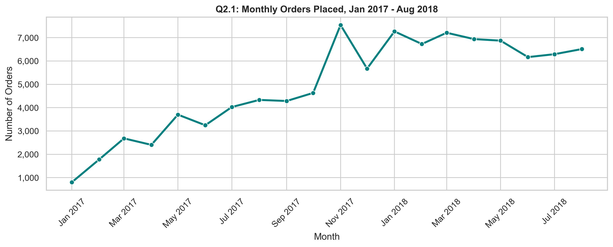
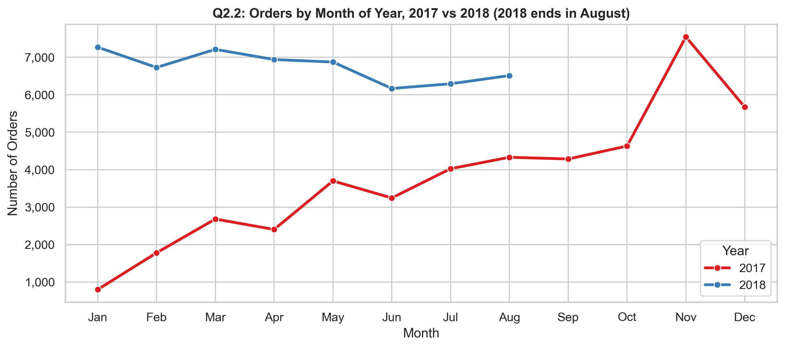
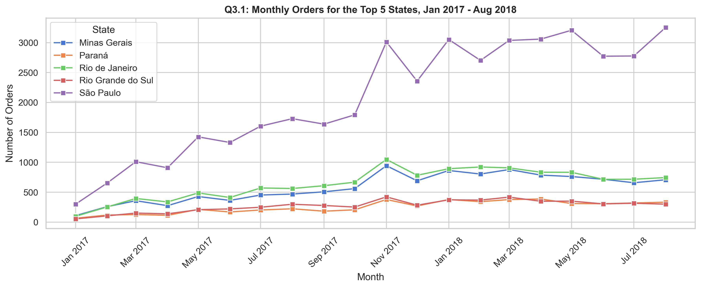
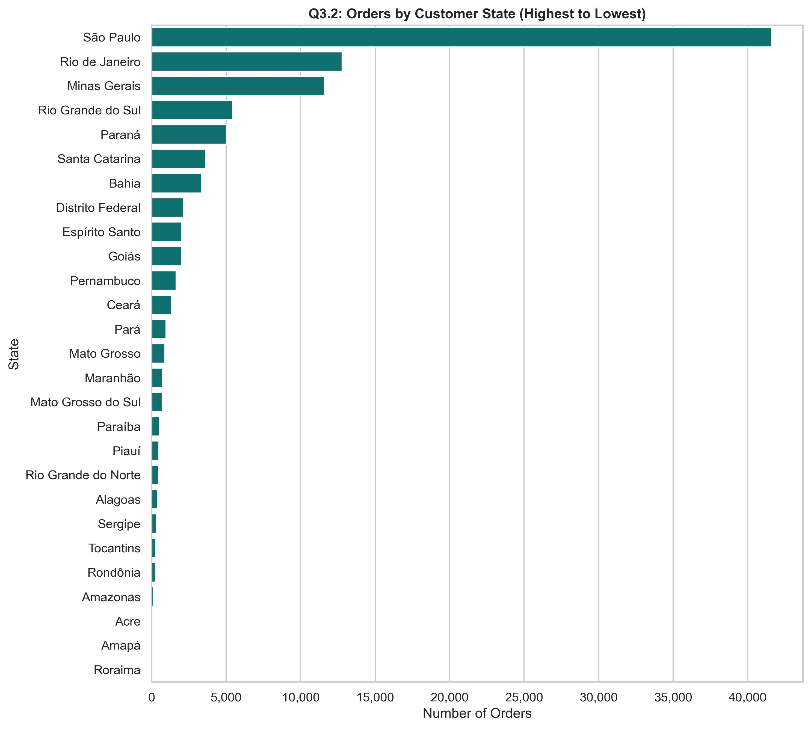
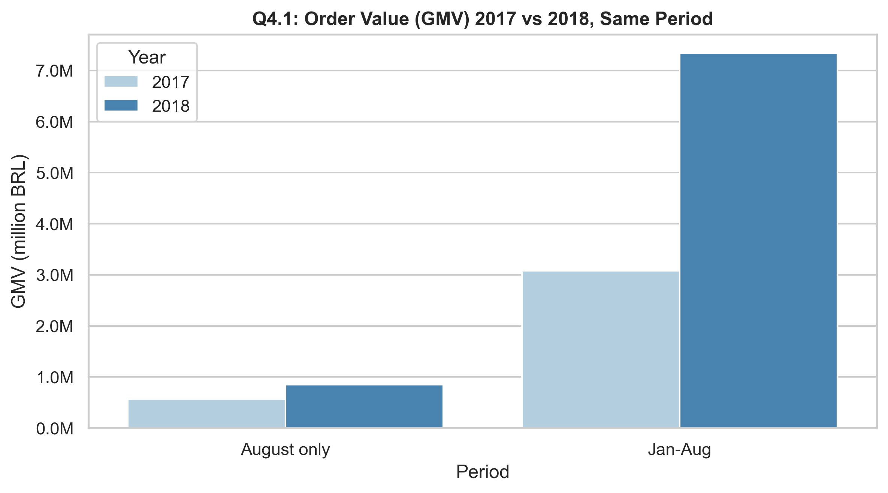
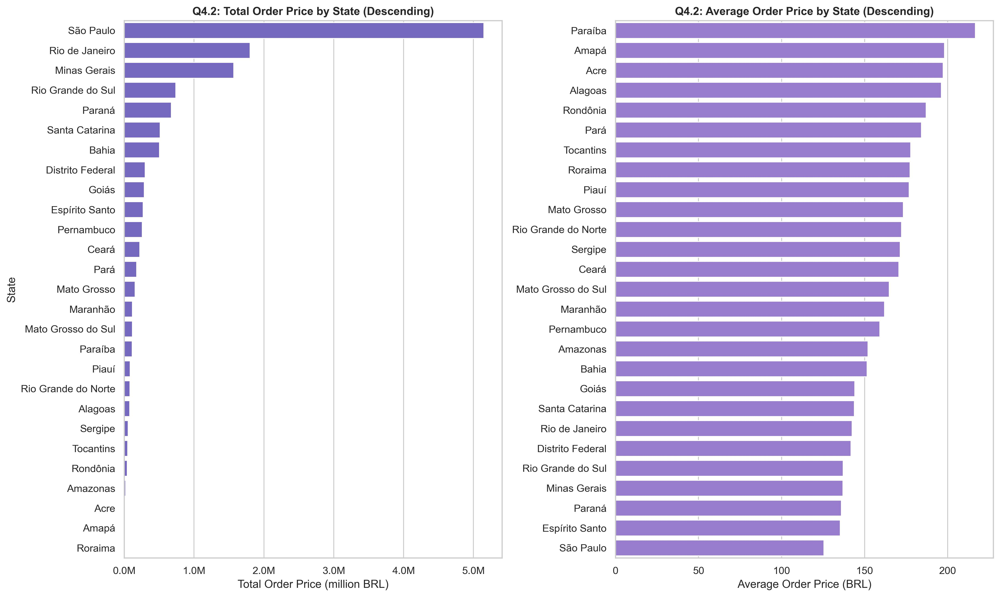
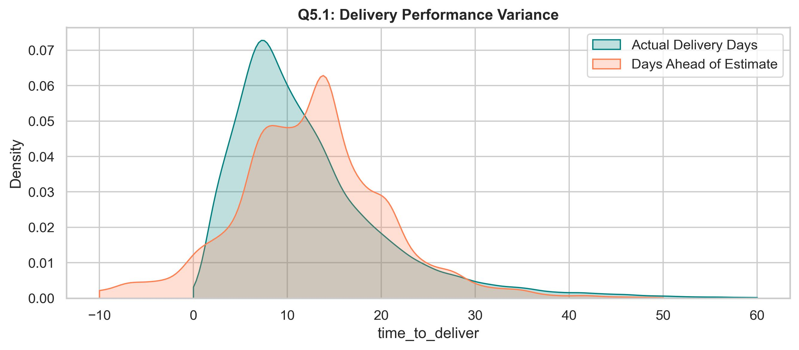
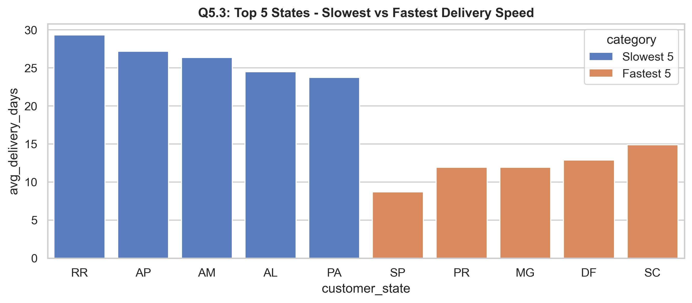

# Brazilian E-commerce Sales and Fulfillment Analysis, 2016-2018: Growth, Seasonality, Delivery vs. Estimates
BigQuery + SQL analysis of Target Brazil retail transactions using order, customer, payment, and fulfillment data.

## Executive Summary
The dataset covers roughly 100k orders placed between September 2016 and October 2018 across 4,119 cities and 27 Brazilian states. The business is highly concentrated in the Southeast, especially Sao Paulo, Rio de Janeiro, and Minas Gerais, which together account for about 68% of all orders. This means the business is driven by a few large regional markets, and operational decisions around fulfillment, staffing, and merchandising should be weighted toward those areas.

Order volume rose substantially from 2017 to 2018, with strong seasonality and a clear concentration of purchases during daytime and peak shopping months. For Brazil, the pattern is not a single Black Friday event but a broader e-commerce growth trend with repeated demand spikes. Payment behavior is also highly skewed toward credit cards, which represent roughly 74% of transactions, while UPI is the second-largest method at about 19%. This matters for conversion design and installment-based promotions.

Delivery execution is generally healthy but uneven across states. Delivered orders take about 12.1 days on average from purchase to customer receipt, and 92% arrive on or before the estimated delivery date. However, remote and lower-connectivity states such as RR, AP, AM, and AL see much longer delivery times and much higher shipping costs, which suggests freight inefficiency and last-mile bottlenecks. The strongest operational opportunity is not to chase all states equally, but to optimize the Southeast-heavy demand base while redesigning carrier and fulfillment strategies for the slower remote states.

## Watch Video Presentation

## About Business
Target is a globally renowned retail brand and a prominent retailer in the United States. The company operates a store experience, e-commerce website, and apps designed to make shopping simple and seamless. This project analyzes Target's Brazilian operations using public transactional data to understand order growth, customer geography, freight economics, and delivery performance.

## Problem Statement
The objective of this analysis is to perform exploratory data analysis on Target Brazil's e-commerce dataset and translate the data into actionable business insight. The project evaluates customer geography, order volume, payment behavior, seller and fulfillment performance, freight costs, delivery speed, and order timing to inform operational planning and performance management.

## Data Schema (ERD)
* Tables:
    * customers.csv
    * geolocation.csv
    * order_items.csv
    * payments.csv
    * order_reviews.csv
    * orders.csv
    * products.csv
    * sellers.csv
* Approximate total records: 100k orders across the public dataset

## Metrics

**Primary metrics**
* Monthly order count by `order_purchase_timestamp` month: answers whether demand is growing over time.
* Delivery gap: `order_estimated_delivery_date - order_delivered_customer_date` in days, for delivered orders only. Positive means early; negative means late.

**Supporting metrics**
* On-time or early delivery rate: share of delivered orders with gap >= 0
* Average purchase-to-delivery time by state
* Total and average order value (`price` per order) and freight (`freight_value` per order)
* Payment mix by `payment_type`, month, and year
* Average `payment_installments` by payment type
* Order volume by state and by time of day

**Guardrail metrics**
* Order status mix: delivered vs. shipped, canceled, unavailable, and other non-delivered states
* Non-delivered orders excluded from delivery performance analysis
* Monthly counts flagged for partial 2016 coverage and incomplete late-2018 coverage
* Median and mean reported together where distributions are skewed

## Insights

### Growth and seasonality
|  |  |
| --- | --- |
|  |  |

* The order base increases from 2017 to 2018, indicating sustained e-commerce expansion rather than a single short-lived spike.
* Monthly ordering is seasonal, with several high-volume months across the year and a strong concentration in the middle and late parts of the year.
* Afternoon and evening purchases dominate the order mix, suggesting the busiest customer activity is in the 12:00–22:00 window.

### Regional demand concentration
|  |  |
| --- | --- |
|  |  |

* Demand is highly concentrated in a few states: São Paulo alone represents about 42% of all orders, followed by Rio de Janeiro and Minas Gerais at roughly 13% and 12% respectively.
* The top five states account for the majority of e-commerce activity, which supports a network strategy that is centered on the Southeast and nearby high-volume hubs.
* This pattern means expansion and space planning should prioritize fulfillment density in the strongest markets rather than spreading assets evenly across all regions.

### Payment behavior and order economics
|  |  |
| --- | --- |
|  |  |

* Credit cards are the dominant payment method, accounting for about 74% of transactions. UPI is the second-largest method at roughly 19%, while voucher and debit card are secondary channels.
* Average order value is around R$137.75, with average freight of about R$22.82 per order. Freight represents around 16.6% of the average order value, which is meaningful but not dominant enough to erase the value of volume growth.
* Payment usage is not evenly distributed across every state, which matters for localized promotions, installment offers, and checkout design.

### Delivery performance and logistics risk
|  |  |
| --- | --- |
|  |  |

* Delivered orders take an average of 12.1 days to reach the customer, with a median of 10 days. This suggests that the median experience is strong, while a small set of longer-tail outliers pulls the mean upward.
* The average delivery gap versus estimate is about +10.9 days, which means most orders arrive earlier than promised. About 92% of delivered orders arrive on or before their estimated date.
* The operational challenge is state-level imbalance: remote states such as RR, AP, AM, and AL have substantially slower average transit times and much higher freight values, while SP and nearby states remain comparatively efficient.

## Recommendations
1. **Prioritize Southeast fulfillment capacity**
   * Maintain or expand fulfillment, inventory, and last-mile capacity in **SP, RJ, and MG**, where most customer demand is concentrated.
   * A hub-and-spoke model around the Southeast is more efficient than a broad national footprint.

2. **Rework logistics strategy in high-fright states**
   * States like **RR, AP, AM, AL, and PA** show both high freight costs and slow delivery times. This points to carrier underperformance, long-haul routing, or sparse network density.
   * Consider regional carriers, cross-docking, or routed consolidation to reduce shipping cost in these states.

3. **Set delivery promises more precisely**
   * Because many orders arrive earlier than estimated, the current delivery estimate appears conservative. Tightening estimated lead times can improve customer experience without harming trust, but the model should still account for remote-state variance.

4. **Align payment offers to the dominant mix**
   * Credit cards dominate transactions, so installment offers and cashback promotions remain relevant levers. In regions with heavy voucher or UPI usage, localized payment messaging may also improve conversion.
## Limitations
* **Partial coverage across time.** The dataset includes a partial year in 2016 and only through October in 2018, so the time series is not fully balanced across the full 2016–2018 period.
* **Delivery metrics are computed only for delivered orders.** Canceled, unavailable, and other non-delivered states are excluded from the speed-and-variance analysis.
* **State-level interpretation is approximate.** Customer state reflects where the order was placed or delivered, but the operational origin of the shipment may differ from the customer geography.
* **No margin or profitability data.** The analysis can quantify volume, shipping cost, and delivery behavior, but cannot determine unit economics or profitability by product, seller, or region.
* **Public benchmark data only.** This is a public e-commerce dataset and may not fully capture all of Target Brazil's operating conditions, seasonality, or network constraints.

## Tech Stack
* BigQuery
* SQL (CTEs, window functions, date logic)
* Python and Pandas for exploratory analysis
* Matplotlib and Seaborn for chart generation

## How to run
* Open `retail_sales_and_fulfillment_analysis.ipynb` in Jupyter or VS Code.
* Run all cells in order to reproduce the EDA and generate the charts under `assets/charts`.
* If you prefer SQL-only analysis, load the CSV files from `assets/dataset` into a database and run the queries in the notebook.
